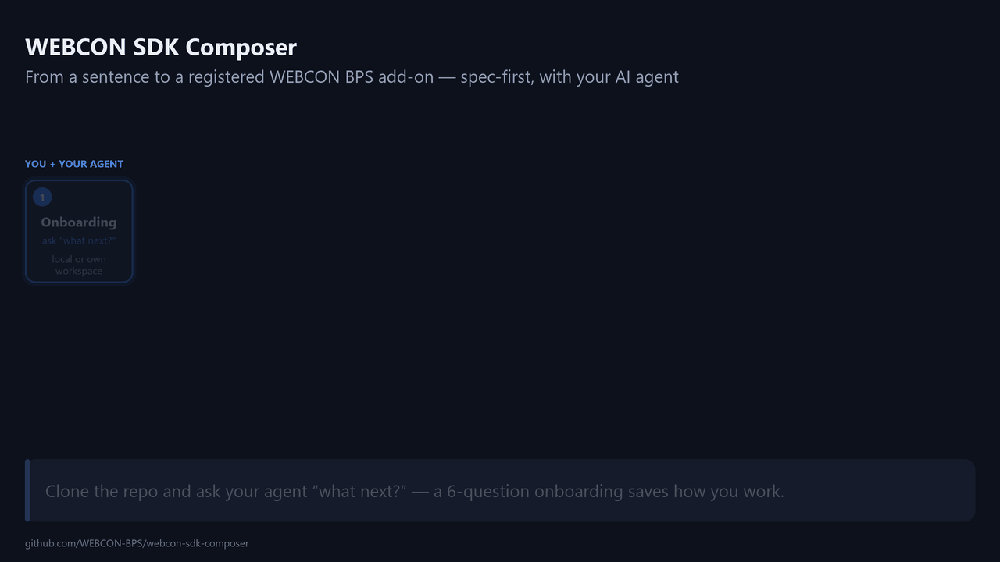
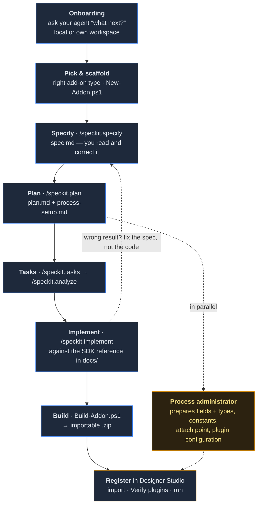

# WEBCON SDK Composer

Build a **WEBCON SDK add-on** by describing what you want, in your own words, to an AI
coding agent — and get back a package you can register in Designer Studio.

Writing an SDK add-on has never been hard. It has been *tedious*: set up the project, find
the right interface in the docs, write the boilerplate, get the manifest right, build,
package, register, iterate. This repository removes the tedium and keeps the part that
matters — deciding what the add-on should do.

The difference between this and pasting a prompt into a chat window is **context and
process**: the whole SDK API reference is checked into the repo, so the model reads
signatures instead of recalling them; Spec-Kit turns your sentence into a spec you can read
and correct before any code exists; and one script turns the result into a package you can
import — no Visual Studio required.

## How it works



<details>
<summary>The same flow as a diagram</summary>



</details>

You and the agent go through the eight steps. Whoever administers the WEBCON process works through
`process-setup.md` at the same time, and the two halves meet at registration.

---

## Quickstart (about 15 minutes)

**You need:** an AI coding agent (Claude Code, GitHub Copilot or Codex), PowerShell (the
Windows PowerShell 5.1 that ships with Windows is enough; PowerShell 7 works too), the
[.NET SDK](https://dotnet.microsoft.com/download) for .NET add-ons, [Node.js](https://nodejs.org)
18+ for JS controls, and a WEBCON environment **with an SDK license** to actually run
what you build.

```bash
git clone https://github.com/WEBCON-BPS/webcon-sdk-composer.git
cd webcon-sdk-composer
```

**0. Ask your agent "what next?"** On a fresh clone it introduces itself and Composer, then asks a
few questions one at a time: whether your add-ons stay in this repository or go to
[your own workspace](#your-own-workspace), the WEBCON version you target, the language for specs.
It saves the answers, checks your machine, and offers to start your first add-on — which does
steps 1–2 below for you.

**1. Pick the add-on type.** [`docs/plugin-types.md`](docs/plugin-types.md) has the decision
table. Unsure? Ask your agent — it reads that file.

**2. Scaffold it.** This gives you a project that already compiles, with the manifest, GUID,
namespace and plugin type correct:

```powershell
./tools/New-Addon.ps1 -Name GusLookup -Type action
```

**3. Say what you want.** In your agent, in whatever language you think in:

> /speckit.specify A custom action that takes a NIP from a form field, looks the company up
> in the GUS API, and fills in the name and address fields. If the NIP is not found, block
> the transition with a clear message.

The agent will ask what it needs to know and write `specs/<n>-gus-lookup/spec.md`. **Read
that file.** It is the deliverable that matters — correcting it is cheaper than correcting
code, and everything downstream is derived from it.

**4. Let it build.** `/speckit.plan` → `/speckit.tasks` → `/speckit.implement`.

`/speckit.plan` also writes `specs/<n>-gus-lookup/process-setup.md` — the fields to create and
their types, the constants, where the plugin attaches, what goes in its configuration, how to
verify it. **Go configure that while the code is being written**; the two halves only meet when
you register the package. Example:
[`specs/example-external-service-call/process-setup.md`](specs/example-external-service-call/process-setup.md).
Changed the configuration later? `/webcon.process-setup` regenerates the page as a delta.

**5. Package it.**

```powershell
./tools/Build-Addon.ps1 -Path addons/GusLookup
```

You get `addons/GusLookup/publish/Webcon.Addon.GusLookup.zip` — the same package Visual
Studio's SDK Tools would publish, assembled the same way. See
[`docs/packaging.md`](docs/packaging.md).

**6. Register it.** Designer Studio → **Plugin packages → New package** → pick the zip →
**Verify plugins**. Details: [`docs/deploy-designer-studio.md`](docs/deploy-designer-studio.md).

---

## Your own workspace

By default everything you build lands in this clone (`specs/`, `addons/`). For real work, point
Composer at your own directory — typically a local clone of your add-ons repository — and your
specs go to `<workspace>/specs/`, your add-ons to `<workspace>/addons/`, and this clone stays
untouched. Your add-ons keep their own history, and pulling a newer Composer never conflicts
with them.

```powershell
./tools/Initialize-Composer.ps1 -Workspace C:/GIT/my-webcon-addons -CreateWorkspace
```

That prepares the directory (`specs/`, `addons/`, `.gitignore`, a minimal `.specify/`) and saves
the choice in `.composer/settings.json` — per user, ignored by git, editable by hand. From then
on the agent and the tools use it: `./tools/New-Addon.ps1 -Name X -Type action` creates
`<workspace>/addons/X`, `./tools/Build-Addon.ps1 -Path X` builds it. Composer never commits in
your workspace; that is yours to do.

Back to local mode: `./tools/Initialize-Composer.ps1 -Workspace ''`.

---

## When the agent gets it wrong

It will, sometimes. **Fix the spec, not the code.** If the generated action ignores an edge
case, that edge case is missing from `spec.md` — add it there and re-run `/speckit.implement`.
Patching the code directly gets you a working add-on that nobody can reproduce or explain,
which is the thing this repository exists to avoid.

## What's in here

```text
addons/         your add-ons — one folder each
templates/      the starting points New-Addon.ps1 copies (.NET plugin, JS custom control)
examples/       a complete worked add-on, paired with its spec in specs/
specs/          Spec-Kit artifacts: spec → plan → tasks, one folder per feature
docs/           SDK API reference, add-on types, packaging, deployment, troubleshooting
tools/          New-Addon.ps1 (scaffold) · Build-Addon.ps1 (build + package)
.specify/       Spec-Kit infrastructure and the project constitution
AGENTS.md       the rules every agent follows — CLAUDE.md and copilot-instructions.md point here
```

## Add-on types

| Type | What it does |
|---|---|
| Custom action | runs code on a path, button, timer or cyclical job |
| Custom business rule | returns a value the form can use |
| Custom data source | feeds pickers, reports and choice fields |
| Form field extension | server-side hooks around a standard field |
| JS custom control | your own React UI inside a form field |
| External control | a whole web app embedded in an iframe |
| Custom label print | your own barcode/label payload |
| Custom authentication | a pre-authenticated client for an unusual API |

Full table with the "which one do I actually need" reasoning:
[`docs/plugin-types.md`](docs/plugin-types.md).

## Works with your agent

| Agent | Reads | Commands |
|---|---|---|
| Claude Code | `CLAUDE.md` → `AGENTS.md` | `.claude/skills/` |
| GitHub Copilot | `.github/copilot-instructions.md` → `AGENTS.md` | `.github/prompts/` |
| Codex and others | `AGENTS.md` | — |

Use whichever your company already pays for. Nothing here is agent-specific.

## Documentation

- [Add-on types and how to choose](docs/plugin-types.md)
- [.NET SDK API reference](docs/sdk-reference/) — base classes, params, config attributes, document model, helpers
- [JS custom controls](docs/js-custom-control.md) — component contract, local workbench, packaging
- [External (iframe) controls](docs/external-control-iframe.md) and the [form JS API](docs/form-js-api/js-api-reference.md)
- [Building the package](docs/packaging.md) · [Deploying to Designer Studio](docs/deploy-designer-studio.md)
- [Dependencies](docs/dependencies.md) — the #1 integration gotcha
- [Troubleshooting](docs/troubleshooting.md)
- Official: [developer.webcon.com](https://developer.webcon.com) · [example add-ons](https://github.com/WEBCON-BPS)

## Contributing

Found a gap, a wrong signature, a missing guide? Open an issue or a PR — see
[CONTRIBUTING.md](CONTRIBUTING.md).

## License

MIT — see [LICENSE](LICENSE).
